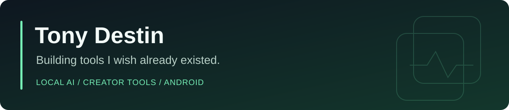
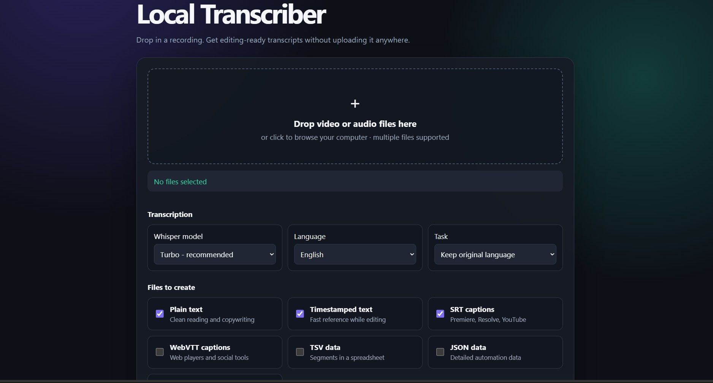
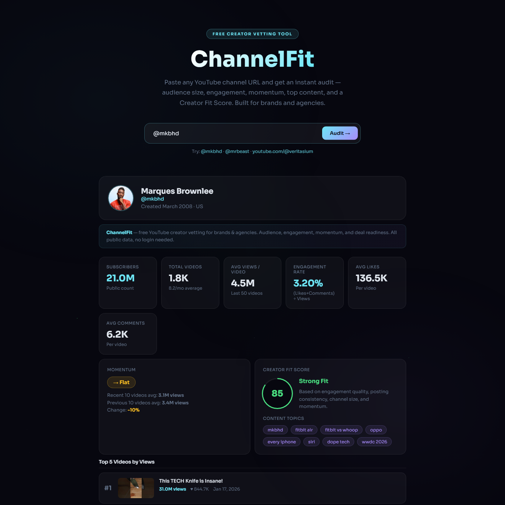

I build tools for the work I do and the everyday problems I run into: handling media, researching creators, running AI locally, and making Android apps more useful.

Some are tools I use. Others are experiments I'm still testing. The goal is to make something useful and show how it works.

[LinkedIn](https://www.linkedin.com/in/tonydestin/) · [All projects](https://github.com/limmieo?tab=repositories)

## Featured builds

<table>
<tr>
<td colspan="2" valign="top">
<h3>💬 <a href="https://github.com/limmieo/LimmiTalk">LimmiTalk</a></h3>

<strong>Local Windows dictation I use every day.</strong>

A lightweight <a href="https://github.com/nexos-1/localflow">LocalFlow</a> fork with CUDA Whisper, personal vocabulary, context hints and recoverable text.

Hold <strong>Ctrl + Windows</strong>, speak, and release to put text into the app you're using. LimmiTalk runs in the tray and keeps speech processing on your PC.

Python · Whisper / CUDA · SQLite · Windows

<a href="https://github.com/limmieo/LimmiTalk">Explore the project →</a>
</td>
</tr>
<tr>
<td width="50%" valign="top">
<h3>🎙️ <a href="https://github.com/limmieo/LocalScribe">LocalScribe</a></h3>

<strong>Turn recordings into material you can work with.</strong>

A local-first transcription studio for transcripts, captions, speaker labels and highlight candidates, with web and desktop interfaces.

Python · Whisper · pyannote.audio

<a href="https://github.com/limmieo/LocalScribe">Explore the project →</a>
</td>
<td width="50%" valign="top">
<h3>🎯 <a href="https://github.com/limmieo/channelfit">ChannelFit</a></h3>

<strong>Get a clearer picture of a YouTube creator.</strong>

A creator-vetting tool for brands and agencies. It brings public channel data, engagement, upload frequency, momentum and a fit score into one view.

JavaScript · YouTube Data API · Netlify Functions

<a href="https://github.com/limmieo/channelfit">Explore the project →</a>
</td>
</tr>
<tr>
<td width="50%" valign="top">
<h3>🔋 <a href="https://github.com/limmieo/rokid-battery">Rokid Battery</a></h3>

<strong>Check your glasses' battery at a glance.</strong>

An unofficial Android companion with a battery notification, charging indicator and 4x1 widget. Tap either to open the official Hi Rokid app.

Java · Android · Hardware-tested on Rokid Style / Galaxy S24 FE

<a href="https://github.com/limmieo/rokid-battery">Explore the project →</a>
</td>
<td width="50%" valign="top">
<h3>🎬 <a href="https://github.com/limmieo/brandflow-Ai">BrandFlow AI</a></h3>

<strong>Make repeatable video branding less repetitive.</strong>

A configurable video-processing backend for adding branded watermarks, caption overlays and outros, with separate profiles for different brands.

Python · Flask · FFmpeg · Workflow automation

<a href="https://github.com/limmieo/brandflow-Ai">Explore the project →</a>
</td>
</tr>
</table>

## Extending an app I use

**[LocalSend: Android background receiving experiment](https://github.com/limmieo/localsend-background-receive)**

An independent fork adding optional background receiving, incoming-request alerts and sound controls. My work focuses on those Android additions and on-device testing. **LocalSend and its contributors built the original app**; this is an experimental fork, not an official release.

## Another build

**[Media Downloader](https://github.com/limmieo/media-downloader)** — a FastAPI web app for downloading and converting media, with FFmpeg processing and a JavaScript frontend.

## A look at the interfaces

<strong>LocalScribe: transcription and export controls</strong>

 

<strong>ChannelFit: example creator audit</strong>

 

<em>Project demo screenshot. The example figures are not live creator metrics.</em>

## What connects these projects

- A problem I want to solve, rather than a feature list for its own sake.
- AI-assisted development, with checks and real-device testing where relevant.
- Clear setup notes, honest limitations, and credit for the projects I build on.

**Tools I work with:** Python, JavaScript, Java, Dart/Flutter, Flask, FastAPI, FFmpeg and local AI models.

I'm open to conversations about creator tools, local AI and practical Android utilities. [Connect on LinkedIn](https://www.linkedin.com/in/tonydestin/).

Project status and licensing vary. See each repository for setup, test coverage and usage terms.

